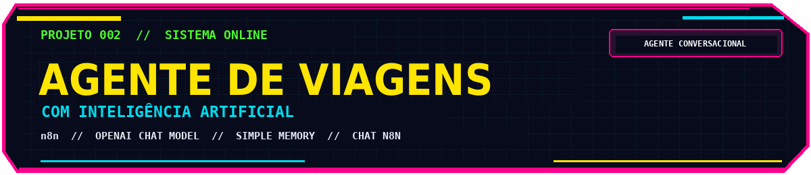
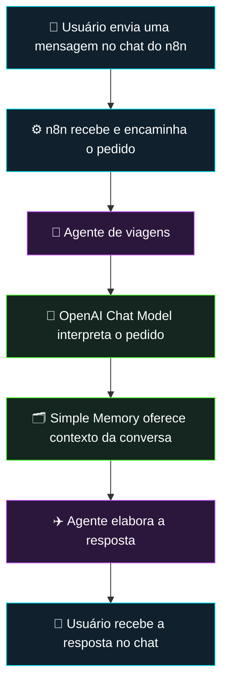
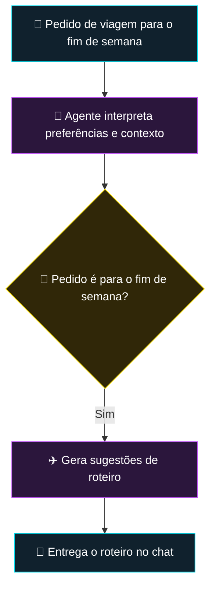
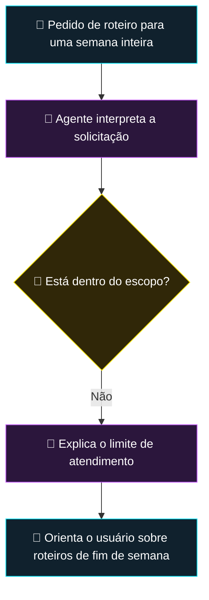

  

# ✈️ Agente de Viagens com IA

### Roteiros personalizados para o fim de semana, criados por um agente conversacional com memória

  
  
  
  

---

## 01 // Visão geral

O **Agente de Viagens com IA** é uma automação que desenvolvi durante a imersão **Jornada de Dados** para ajudar pessoas a planejar viagens curtas. Em vez de pesquisar e organizar as sugestões manualmente, o usuário descreve o que procura e recebe um **roteiro de fim de semana gerado por inteligência artificial**.

O fluxo foi construído no **n8n** com um **agente de IA**, um nó **OpenAI Chat Model** para processar as solicitações e um nó **Simple Memory** para manter o contexto conversacional. Na implementação registrada, a interação ocorre por meio do **chat do próprio n8n**.

O agente foi configurado para conversar de forma **amigável e descontraída** e seguir um limite claro: **gerar roteiros de viagem para o fim de semana**. Quando o pedido foge desse propósito — por exemplo, um roteiro para uma semana inteira —, ele explica a restrição ao usuário, explorando o conceito de limitação de escopo para agentes conversacionais.

## 02 // Problema e solução

**Problema:** escolher um destino e planejar o que fazer em um fim de semana pode exigir várias pesquisas e a organização manual das opções.

**Solução:** oferecer um agente conversacional capaz de interpretar um pedido em linguagem natural, considerar as preferências informadas e devolver sugestões de roteiro dentro do escopo definido.

| Necessidade | Resposta da solução |
|---|---|
| Fazer um pedido sem preencher um formulário extenso | Conversa em linguagem natural |
| Obter ideias personalizadas para uma viagem curta | Roteiro gerado com apoio do OpenAI Chat Model |
| Dar continuidade à conversa | Contexto mantido pelo Simple Memory |
| Evitar solicitações fora da proposta | Orientação do agente para restringir o atendimento a viagens de fim de semana |

## 03 // Arquitetura da solução

A arquitetura preservada é enxuta: **um gatilho de mensagem, um agente de IA e dois componentes conectados ao agente**. A função do n8n é receber a conversa, orquestrar o processamento e apresentar a resposta.

Vale ressaltar que aqui ele foi construído para ser usado dentro do modelo de chat do **N8N**, mas nada impede que no lugar deste nó seja implantado um bot telegram ou whatsapp para atuar nestes sistemas.

### Responsabilidades de cada componente

| Componente no n8n | Responsabilidade |
|---|---|
| **When chat message received** | Inicia a execução quando uma mensagem é enviada pelo chat. |
| **AI Agent** | Recebe o pedido, segue as orientações definidas para viagens de fim de semana e prepara a resposta. |
| **OpenAI Chat Model** | Fornece o modelo de linguagem utilizado pelo agente para interpretar o pedido e produzir conteúdo. |
| **Simple Memory** | Disponibiliza contexto conversacional para o agente durante a interação. |

## 04 // Como funciona na prática

### Cenário A — Pedido dentro do escopo

**Exemplo ilustrativo de solicitação:**

> “Gostaria de um roteiro para passar o fim de semana em São Paulo.”

O **OpenAI Chat Model** dá suporte à interpretação e à geração do texto, enquanto a **Simple Memory** pode oferecer o contexto já estabelecido na conversa. O resultado é uma sugestão personalizada conforme as informações disponibilizadas pelo usuário.

### Cenário B — Pedido fora do escopo

Na demonstração descrita, foi testado um pedido de **roteiro para uma semana inteira**. Como o agente foi configurado para atender viagens de fim de semana, ele informa a limitação em vez de assumir uma tarefa fora do seu propósito.

> **Importante:** a decisão de escopo é um **comportamento configurado nas instruções do agente**

## 05 // Decisões técnicas e aprendizados

**Agente com propósito delimitado.** A restrição a roteiros de fim de semana evita que a aplicação assuma demandas incompatíveis com o objetivo para o qual foi configurada. Isso demonstra a importância de definir instruções e limites de atuação para agentes conversacionais.

**Modelo de linguagem conectado ao agente.** O nó **OpenAI Chat Model** foi utilizado como motor de interpretação e geração de respostas. O projeto demonstra uma aplicação prática de IA generativa para transformar pedidos abertos em sugestões úteis.

**Memória de conversa.** A conexão com **Simple Memory** permite ao agente considerar contexto entre mensagens, em vez de tratar necessariamente cada texto de forma isolada.

**Orquestração com n8n.** A plataforma reúne o gatilho do chat, o agente e os recursos de IA em um fluxo visual, facilitando o desenvolvimento e a evolução da solução.

**Experiência conversacional.** A configuração de uma linguagem amigável e descontraída foi uma escolha de experiência de usuário, adequada ao contexto de planejamento de lazer.

## 06 // Tecnologias utilizadas

| Tecnologia | Aplicação no projeto |
|---|---|
| **n8n** | Orquestração da conversa e dos componentes do fluxo |
| **AI Agent (n8n)** | Execução da proposta conversacional e aplicação das instruções de escopo |
| **OpenAI Chat Model** | Interpretação das mensagens e geração das sugestões de roteiro |
| **Simple Memory** | Memória de contexto do atendimento |
| **Chat do n8n** | Canal utilizado para testar e demonstrar o agente |

## 07 // Demonstração e evidências

A automação foi apresentada em uma publicação com demonstração de uso, incluindo um exemplo de solicitação fora do escopo permitido.

---

  

